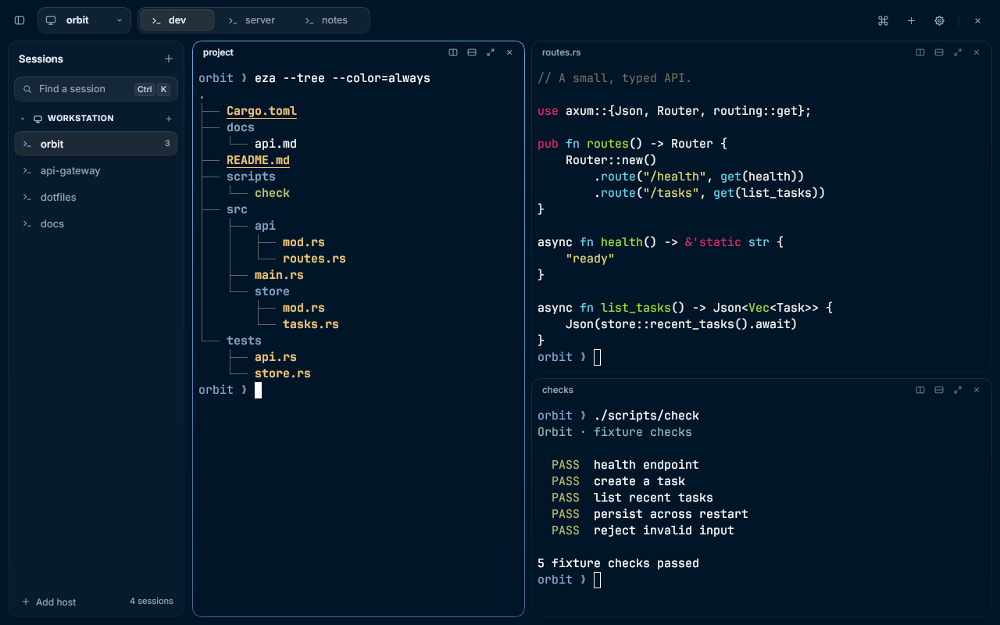

# Rex Linux

An unofficial, independent native Linux client for [Rex](https://www.superlogical.com/rex), the terminal multiplexer from Superlogical. It is not affiliated with, endorsed by or supported by Superlogical or the Rex authors.



Rex Linux attaches to an existing Rex server. Saved hosts contain sessions, each session's Rex windows become tabs, and the server defines the terminal splits. Sessions and their programs stay on the server when the app closes, so any other Rex client can attach to the same sessions.

It is written in Rust on [Rune](https://github.com/anomalyco/rune) (wgpu/winit, `rune-kit` components) with libghostty-vt for terminal emulation, and talks to the server through the [`rexrs`](https://github.com/a10y/rexrs) control SDK.

> **Status:** early. The protocol layer, workspace, terminal rendering and input are implemented and tested against real servers, but some areas (see [Current scope](#current-scope)) still need hands-on validation, and there are no packaged releases yet.

## Features

- Multiple saved hosts, each with its sessions; session windows are tabs and splits follow the server's layout.
- Unix-socket and HTTPS/WSS endpoints (for example a Tailscale-exposed Rex server).
- A single toolbar with session identity, tabs, commands and the window's own controls. A tab with one pane draws it edge to edge; splits are rounded pane cards. Tabs close from their right-click menu, a middle-click or `Ctrl Shift W`, always behind a confirmation. Host-grouped session navigation opens on demand, with an optional sidebar (Ctrl Shift B) that opens at launch as it was left. Tabs can sit in the toolbar or, while the sidebar is open, under each session in the sidebar.
- Searchable session switcher (`Ctrl K`) and command palette (`Ctrl Shift P`).
- Snapshot restore, live output, physical-layout key press and release forwarding with dead-key composition, bracketed paste, text selection and copy, local scrollback, and mouse/wheel reporting for terminal programs. Right-click always opens the pane menu; Shift+right-click sends the click to a program that tracks the mouse, and Shift with the left button selects text locally.
- Inline Kitty graphics (RGB, RGBA and PNG), including image-bearing snapshots on reattach. Ghostty resolves placement, crop and paint order; the client caches decoded pixels and textures. Image storage is capped at 64 MiB per terminal. File, temporary-file and shared-memory image media are disabled: remote terminal output cannot read local files.
- Synchronized output (mode 2026): while a program holds an update open (for up to a second, as in Ghostty) the pane keeps its last frame, so full-screen programs redrawing after a resize don't flash blank.
- Links: Ctrl+click opens an `http`, `https`, `ftp` or `mailto` link with `xdg-open`, whether it is an OSC 8 hyperlink or a URL in the text (including one that soft-wraps across rows). Holding Ctrl over a link underlines it, shows a hand pointer and, after a moment, a tooltip naming its real target, so OSC 8 text cannot disguise where it goes. Ctrl+click works over programs that track the mouse too; clicks elsewhere still go to the program. Other schemes, `file://` among them, are never opened, since output may come from a remote host.
- Reconnect handling: a transport failure pauses input on affected panes (input is never replayed) while parsed output survives reconnects and session changes. TCP connections are probed when idle, so a server that dropped this client while the network was gone (a laptop asleep, for example) is noticed within about 30 seconds and the host and its terminals reconnect.
- Program activity on tabs. Programs that report their status with OSC 7501 (coding agents, for example) mark their tab with a word when they need you ("Needs approval", "Question", "Needs sign-in", "Needs input") or fail ("Error"), and with "Done" when they finish in a tab you weren't looking at. Each tab shows its focused pane's program icon (Claude Code, Codex, OpenCode, Pi, Vim, Git, Cargo, SSH; otherwise `>_`), and a tab you haven't renamed takes the title its program sets (OSC 0 or 2), as a terminal window would. Needs a server with API revision 8.
- Desktop notifications through the freedesktop notification service when a tab you aren't looking at needs you, fails or finishes, and for notifications programs send themselves (OSC 9 and OSC 777). Clicking one raises the window and shows that tab. Each kind can be turned off in Settings → Notifications.
- Agent integrations (Settings → Integrations): installs, updates or removes Rex's skill and session hooks for Claude Code, Codex, OpenCode, Pi and OMP on this machine with the local `rex skill` command. OMP reads the shared `~/.agents/skills/rex` skill used by Codex, OpenCode and Pi; it does not have a Rex session hook. `rex skill` has no OMP agent yet, so until it does, OMP's row changes Pi's skill: installing or removing it for one does the same for the other. Every change is previewed with a dry run first, including every agent affected by that shared skill. "Let agents name sessions" is passed to every setup explicitly.
- Interface zoom (70–150%) and a configurable terminal font and size.
- Chrome palettes (Settings → Interface → Theme): **Midnight** (the default), **Rosé Pine**, **Rosé Pine Moon** and **Gruvbox Dark**, all dark, applied at once without restarting. Each pairs with a built-in terminal theme of the same name whose background is the chrome's ground. Until you pick a terminal theme yourself, choosing a palette moves the terminal theme from Follow server to **Follow chrome**, which declares the palette's paired theme to the server as below; a terminal theme you picked is left alone.
- Terminal themes (Settings → Terminal → Theme). **Follow server**, the default, declares nothing and shows whatever colours the server has, as long as this client has never declared a theme. **Rex default colours**, **Follow chrome** (the chrome palette's paired theme), the built-in **Midnight**, **Rosé Pine**, **Rosé Pine Moon** and **Gruvbox Dark**, or any Ghostty theme file are declared to the server with Rex's `set_theme`, which the server applies to panes this client owns or nobody owns; while another client owns a pane, the server keeps that client's colours and applies ours when this client takes the pane. New tabs and splits are created with the theme. Ghostty themes are read from `$XDG_CONFIG_HOME/ghostty/themes` (default `~/.config/ghostty/themes`), then `$GHOSTTY_RESOURCES_DIR/themes`, then `ghostty/themes` under each `$XDG_DATA_DIRS` entry; the first file with a name wins. Selection and cursor-text colours from a theme are drawn by this client. Rex keeps this client's last theme for each pane across launches and applies it whenever this client owns the pane, so once this client has declared any theme (remembered as `terminal_theme_declared`, never cleared automatically), Follow server sends one empty `set_theme`, Rex's own colours, to each pane this client owns or nobody owns: once per pane per connection, when its stream starts, when this client takes it, and again after a reconnect. A server without `set_theme` is reported once and the choice is kept for other hosts.
- Borderless window with its own close button, edge resizing and drag region. There are no minimize or maximize buttons; double-clicking the drag region maximizes, and the window manager handles the rest.
- Keys are sent by physical position (Ghostty key names), so non-US layouts work.

**Attachment only.** Rex Linux never starts, stops, replaces or reconfigures a Rex server and attaching does not need a `rex` executable. The only place the app runs `rex` is Settings → Integrations, on this machine and always with `--autostart=false`; it searches `PATH`, then `$XDG_BIN_HOME` or `~/.local/bin` for desktop launches that do not inherit the shell's path. An unavailable server is shown as disconnected and retried. Closing the client leaves server programs running.

## Requirements

- Rust 1.96 or newer (edition 2024; see `rust-version` in `Cargo.toml`).
- [Zig](https://ziglang.org/) 0.17.x. The `ghostty-vt` crate builds Ghostty's VT library from a checksum-pinned source archive with Zig.
- Linux with Wayland or X11, plus the usual graphics/input libraries: Vulkan, xkbcommon, fontconfig and the Wayland/X11 client libraries.
- A running Rex server that supports API revision 7 or 8. The client negotiates revision 8 when available and falls back to 7, including on newer servers that offer compatibility.

## Build

```sh
cargo build --locked --release --bin rex-linux
```

Optionally, [mise](https://mise.jdx.dev/) can provide the toolchain: [`mise.toml`](mise.toml) pins Rust 1.96.1 (with Clippy and rustfmt) and Zig 0.17.1, and `mise run build` runs the command above. Run `mise trust` and `mise install` once first. Mise does not provide the native Linux libraries listed in [Requirements](#requirements).

The repository is also a Nix flake: `nix build .#rex-linux` builds a package with the desktop entry and icons, and `nix develop` gives a shell with the toolchain and libraries. See [Nix packaging](docs/nix.md).

`Cargo.lock` pins the dependency graph. TLS uses Rustls with the system trust roots. The workspace also builds two protocol probes (`rex-probe`, `rex-workspace-probe`) that do not need the UI; use `--no-default-features` to build only those.

## Run

```sh
# Create a persistent session on the local Rex server.
target/release/rex-linux --new work

# Reattach to an existing session by exact label or ID.
target/release/rex-linux --session work

# Attach to a remote server (for example one exposed over Tailscale).
target/release/rex-linux --endpoint https://my-host.example.ts.net --session work

# Choose a terminal font and size.
target/release/rex-linux --session work --font 'JetBrainsMono Nerd Font' --font-size 15
```

Options:

| Option | Meaning |
| --- | --- |
| `--endpoint <URL>` | `unix:///absolute/path.sock`, `https://…`, `http://…`, `wss://…` or `ws://…`. Defaults to `$REX_SERVER`, then `unix://$XDG_RUNTIME_DIR/rex/server.sock` (or `unix:///run/user/1000/rex/server.sock` if `XDG_RUNTIME_DIR` is unset). |
| `--session <LABEL\|ID>` | Select a session by exact label or ID. Missing or ambiguous names never pick an arbitrary session. |
| `--new <LABEL>` | Explicitly create a persistent session (conflicts with `--session`). Ordinary attachment never creates or destroys sessions. |
| `--block <ID>` | Initially focus this terminal block. |
| `--font <FAMILY>` | Override the saved terminal family for this launch. Fonts are resolved through fontconfig; an unavailable primary family uses bundled IBM Plex Mono and reports it on stderr. |
| `--font-fallback <FAMILY>` | Override the saved fallback list for this launch. Repeat for an ordered list. fontconfig's fallbacks for the terminal family and system script/symbol fallbacks remain available. |
| `--font-size <PT>` | Override the saved terminal size (8–48 pt, initially 15). |
| `--config <PATH>` | Use a separate workspace preferences file. |
| `--window-size <WxH>` | Requested startup size (default `1440x900`); tiling compositors may override it. |

Without `--session`, the workspace restores the saved host and session; on a new host it selects the first listed session. Rune's own developer flags go after `--` (for example `-- --snap out.png`). `REX_FRAME_STATS=1` prints per-frame CPU percentiles.

### Desktop install

```sh
bash scripts/install-desktop.sh [--copy] [path/to/rex-linux]
bash scripts/install-desktop.sh --uninstall
```

This installs `dev.shuv.rex-linux.desktop` under `$XDG_DATA_HOME/applications` (normally `~/.local/share/applications`) pointing at the release binary of this checkout (or the binary you pass), and the app icon at 32, 128 and 256 px into the user's `hicolor` theme. Without `--copy`, re-run it if you move the checkout. With `--copy`, the binary is copied to `$XDG_BIN_HOME` (normally `~/.local/bin`) and the launcher points there, so it no longer depends on the checkout. `--uninstall` removes the launcher, the icons and the copied binary. It needs `desktop-file-install`, `desktop-file-validate` and `update-desktop-database`; no root access. See [icon provenance](resources/icons/README.md).

With mise, `mise run install` builds the release binary and runs the script with `--copy`, and `mise run uninstall` runs it with `--uninstall`.

## Configuration

Preferences are stored as JSON in `$XDG_CONFIG_HOME/rex-linux/workspace.json` (default `~/.config/rex-linux/workspace.json`): saved hosts (label, endpoint, collapsed state, optional default shell), the last host and session per host, whether the sidebar is open and its width, tab position (`vertical_tabs`), terminal font family (`font_family`), ordered fallback families (`font_fallbacks`), font size, the chrome palette (`chrome_theme`: `"midnight"`, `"rose_pine"`, `"rose_pine_moon"` or `"gruvbox_dark"`; an unknown value is Midnight), the terminal theme (`terminal_theme`: `"follow_server"`, `"builtin_default"` for Rex's own colours, `"follow_chrome"`, or `"named:<name>"` with `rex/midnight`, `rex/rose-pine`, `rex/rose-pine-moon`, `rex/gruvbox-dark` or a Ghostty theme's file name), whether you have picked a terminal theme yourself (`terminal_theme_chosen`) and whether this client has ever declared one (`terminal_theme_declared`), interface zoom (`ui_scale`), the corner notices appear in (`notice_position`), the activity and notification choices (`notifications`) and whether agents may name sessions (`agent_session_naming`). Use `--config <path>` to keep a separate workspace.

Settings (the sliders button in the toolbar, `Ctrl ,`, or Settings… in Commands) has Interface (chrome theme, zoom, sidebar, tab position, notice corner), Terminal (font family, fallback families, size, theme, each host's default shell), Notifications (activity in tabs, desktop notifications and which changes send one), Integrations (Rex's skill and hooks for coding agents on this machine), Remote Hosts (add, edit or remove saved hosts) and Shortcuts sections. A host's name, endpoint and default shell can also be edited from its sidebar header's right-click menu, from Edit host… in Commands, or from an offline session's menu. Removing a host only stops this client connecting to it; its sessions keep running on the server. A changed endpoint connects to that server as a new host.

In Interface settings, **Tab position → Sidebar** lists each session's tabs under it in the sidebar, with their program icon, label and activity word, and takes the tab strip out of the toolbar while the sidebar is open; closing the sidebar brings the strip back without changing the setting. Choosing Sidebar opens the sidebar. Clicking a tab selects its session and window, and Commands and the keyboard shortcuts then act on it as usual. To list the tabs of sessions this client hasn't attached, it reads their layouts with read-only `session.view` requests, one at a time, for expanded hosts while the sidebar shows tabs; it never attaches them or opens their terminals, and a failed read is retried after 1, 5 and then every 30 seconds. **Top** keeps tabs in the toolbar.

In Terminal settings, **Change…** saves the primary family and optional comma-separated fallback families. Family changes take effect when you reopen the client; they do not restart the server or its sessions. The initial family is `JetBrainsMono Nerd Font`, with bundled IBM Plex Mono used if unavailable. Missing glyphs come from the named fallbacks in order, then the fonts fontconfig orders after the terminal family (as `fc-match -s` lists them, so Nerd Font symbols or scripts installed alongside it are found), then bundled IBM Plex Mono, then automatic system fallbacks for other scripts and symbols; an empty fallback list uses only the latter three. The named families and fontconfig's chain are resolved once at startup, and their files are memory-mapped rather than copied. Linux discovery of the automatic fallbacks includes fontconfig's fonts, including fonts installed through Nix. Fallback faces supply missing glyphs without changing the primary font's grid metrics; install a suitable CJK font, such as Noto Sans CJK, for Chinese, Japanese and Korean. `--font` and `--font-fallback` take precedence over saved family choices without replacing them, so remove those flags from launchers when you want Settings to control the family.

A host's default shell (empty means the server user's login shell) is used for every new session, tab and split this client creates on that host. Host endpoints must be `unix://` with an absolute path, or `https://`, `http://`, `wss://` or `ws://` URLs.

## Keyboard shortcuts

| Shortcut | Action |
| --- | --- |
| Ctrl K | Search sessions across saved hosts |
| Ctrl Shift P | Search commands, sessions and current-session tabs |
| Ctrl Shift N / T | New session on the active host / new tab |
| Ctrl Shift D / Ctrl Alt D | Split right / down |
| Ctrl PageUp / PageDown | Previous / next tab |
| Ctrl Alt arrows | Focus an adjacent pane (Alt arrows reach terminal programs) |
| Ctrl Shift Enter | Zoom / restore the focused pane |
| Ctrl Shift Space | Focused-pane actions |
| Ctrl Shift W | Close the focused pane, or the tab when it has one pane (asks first) |
| Ctrl , | Settings |
| Ctrl Shift B | Collapse / restore the sidebar |
| Ctrl Shift C / V | Copy selection / paste (bracketed-paste aware) |
| Ctrl Shift R | Resume the focused terminal's data stream |
| Shift PageUp / PageDown, wheel | Scroll local history |
| Ctrl + / Ctrl − / Ctrl 0 | Enlarge / shrink / reset the whole interface |

These chords are reserved by the client and do not reach terminal programs; every other key goes to the focused pane. Interface zoom changes in 10% steps (70–150%), is saved as `ui_scale`, and is independent of the terminal font size. `Ctrl =` and the numpad `+`/`−` also work.

Double-click selects a word (including shell paths), and triple-click selects a line. Selection stays attached to terminal content as history or output scrolls; dragging above or below the grid autoscrolls. Hold Shift to select locally or scroll local history when a fullscreen TUI owns the mouse. Without Shift, ordinary TUI mouse reporting is unchanged.

Terminal-initiated clipboard writes are limited to 8 MiB and accepted only from the active session's focused pane while the app window is focused and no dialog is open. Background tabs cannot overwrite the clipboard. Clipboard read requests from terminal programs are not supported; the client never sends your clipboard to a remote program without a paste action.

Other interactions: click the session/host identity for grouped navigation, or right-click it for the current session's actions; in the switcher, rename a session in place (right-click its row, F2 or the pencil; Enter saves, Esc cancels) or close it with its ×; right-click a pane for actions targeting that pane; drag dividers to resize splits and the sidebar's edge to resize it (double-click resets); double-click a tab to rename it. Closing a pane or tab asks for confirmation, with **Keep running** as the default. The active window takes size ownership of a terminal automatically. On the borderless window, the toolbar's empty space moves it (double-click maximizes; right-click requests the window manager's menu on Wayland).

## Development

```sh
cargo test --locked --all-features
cargo fmt --all -- --check
cargo clippy --locked --all-targets --all-features -- -D warnings

# Protocol probes against a Rex server (endpoint optional; they create and remove their own sessions).
cargo run --locked --no-default-features --bin rex-probe
cargo run --locked --no-default-features --bin rex-workspace-probe
```

With mise, `mise run test`, `fmt`, `clippy` and `test-rexrs` run the first three commands and the vendored SDK tests; `mise run check` runs them all.

The `scripts/` directory holds integration checks; each script's docstring lists its requirements (Xvfb, xdotool, a `rex` binary, `wayland-info`, …). Some use the configured Rex server rather than starting their own: point them at a disposable server you control. Wayland checks use the running compositor; X11 checks use an isolated display.

- `revision8-check.py`: API revision negotiation and bootstrap tickets against a disposable server, optionally running the probes.
- `connection-only-smoke.py`: a missing or stale socket must never execute the Rex CLI.
- `x11-smoke.py`: real X11 events (forms, clipboard, pointer selection, key isolation).
- `scroll-selection-x11.py`: private-server Unicode copy checks after scrolling, drag autoscroll, and Shift selection in a fullscreen mouse-tracking TUI without breaking ordinary mouse reports.
- `kitty-graphics-x11.py`: private-server pixel checks for live RGBA, chunked PNG, image restoration after reattach and deletion.
- `clipboard-x11.py`: isolated private-server acceptance check for this feature; see its docstring.
- `alt-arrow-x11.py`: isolated private-server acceptance check for this feature; see its docstring.
- `sidebar-x11.py`: private-server check that the sidebar's open state survives relaunch, with captures of both tab positions.
- `rune-acceptance-x11.py`: window-corner, terminal-key and frame-CPU acceptance checks on X11.
- `chrome-spike-x11.py` (with the `chrome_spike` example): borderless window chrome on X11.
- `wayland-seat-smoke.py`: Wayland seat/resource selection on a multi-seat compositor.
- `mouse-check.py`: terminal mouse reporting with real pointer input on a private headless Wayland display.
- `readme-screenshot.py`: regenerates `docs/screenshot.png` from a private Rex server and headless compositor, with a throwaway home and prompt so no local details appear.
- `demo-record.py`: records a demo video of the app on a private headless compositor (uses the `tools/vptr` virtual-pointer helper).

See [AGENTS.md](AGENTS.md) for the code layout and contributor conventions, and [DESIGN.md](DESIGN.md) / [PRODUCT.md](PRODUCT.md) for the design system and product intent.

## Vendored dependencies

Three dependencies are vendored with small, documented patches and wired in through `[patch]` in `Cargo.toml`:

- [`vendor/rune/`](vendor/rune/README.md): the `rune`, `rune-motion`, `rune-staging` and `procwatch` crates from `anomalyco/rune` at `100b7d9` (MIT), with dead-key forwarding and window-chrome additions for a borderless Linux window (maximize/restore, minimize, edge resize, window menu, native window icon).
- [`vendor/rexrs/`](vendor/rexrs/REX-LINUX.md): `a10y/rexrs` at `780be3f` (MIT OR Apache-2.0), plus revision-8 generated types, explicit API-revision range negotiation and preservation of an empty `attach_session_ids`.
- [`vendor/ghostty-vt/`](vendor/ghostty-vt/REX-LINUX.md): the crates.io `ghostty-vt` 0.8.0 source (Apache-2.0; Ghostty itself is MIT), plus a safe wrapper for Ghostty's render-state image iterator, image-aware snapshot decoding, a fixed temporary-file medium setting and grayscale PNG normalization.

Each patch is meant to be dropped once the corresponding upstream release has equivalent APIs.

## Current scope

Still needing hands-on validation: physical Wayland pointer gestures (move, edge resize, double-click, window menu), multi-seat Wayland desktops, input methods beyond dead-key composition, and sustained daily use. On X11, winit has no window-menu request, so right-clicking the drag region does nothing there.

Not implemented: terminal-content search, animated Kitty graphics and accessibility (AT-SPI). Apart from the Nix flake there are no distribution packages (deb, rpm, Flatpak, AUR) or prebuilt releases.

## Third-party software and assets

| Component | License |
| --- | --- |
| [anomalyco/rune](https://github.com/anomalyco/rune) (UI toolkit; vendored crates plus `rune-kit` and `rune-theme-opencode` from git) | MIT |
| [a10y/rexrs](https://github.com/a10y/rexrs) (Rex control SDK; vendored) | MIT OR Apache-2.0 |
| [Ghostty](https://github.com/ghostty-org/ghostty) (terminal core and snapshot format, built by `ghostty-vt-sys`) | MIT |
| [`ghostty-vt`](https://crates.io/crates/ghostty-vt) Rust bindings, pinned `=0.8.0` (vendored with patches) | Apache-2.0 |
| Inter and IBM Plex Mono (bundled through `rune-theme-opencode`) | SIL Open Font License 1.1; license texts also appear in `vendor/rune/crates/rune/assets/` |
| Rex app icon (`resources/icons/`) | Superlogical artwork, not covered by this repository's license; see [resources/icons/README.md](resources/icons/README.md) |

Other crates are used under their own licenses; see `Cargo.lock`.

## Acknowledgements

- [Superlogical Rex](https://www.superlogical.com/rex), the server and protocol this client speaks. The implementation follows the server's `/llms.txt` API revision 8 contract, with a tested revision-7 path.
- [anomalyco/rune](https://github.com/anomalyco/rune) and [a10y/rexrs](https://github.com/a10y/rexrs).
- [Ghostty](https://github.com/ghostty-org/ghostty) for the terminal core.
- [m4nik1/rex-linux-client](https://github.com/m4nik1/rex-linux-client) and [noahdunnagan/rmx](https://github.com/noahdunnagan/rmx), whose protocol work served as references.

## License

MIT. See [LICENSE](LICENSE). Vendored code keeps its own licenses in `vendor/`.
