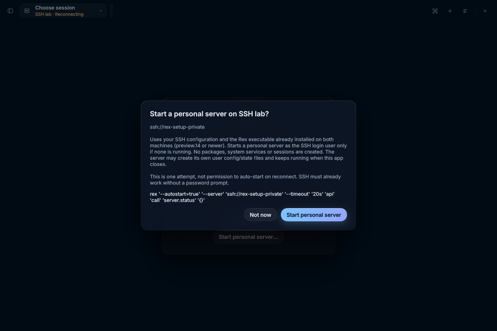
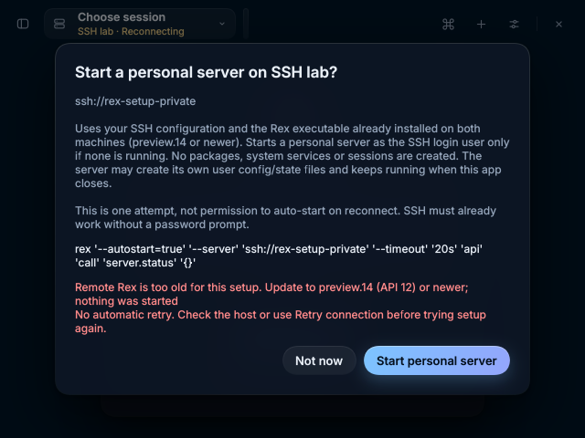

# 0.4.2 verification

## Listener discovery (#13)

Branch `feat/listeners-discovery`, based on `origin/master` at `da8da40`.

- `cargo test --locked --all-features`: 292 passed, 2 pre-existing ignored.
- `cargo clippy --locked --all-targets --all-features -- -D warnings`: passed
  (the pre-existing vendored Rune dependency warning remains).
- `cargo fmt --all -- --check`: passed.
- Debug application build: passed.
- `scripts/keymap-acceptance.py` and `scripts/x11-smoke.py`: passed against
  isolated preview.14 (`7e460d0`, API 12) servers, with explicit `REX_SERVER`.
- Live Add host: a stub Tailscale inventory pointed only at a private preview.14
  loopback listener. The rendered Connect to Rex dialog showed both its Unix
  binding/peer-credential admission and actual TCP binding/anonymous admission.
  No real tailnet was scanned. Screenshots and logs are under
  `~/.cache/agent-ws/rex-042/` on the verification machine.

Tests cover missing/null/empty listeners, revisions 10/11/12, unknown transport
and admission strings, actual rather than configured ports, and reviewing the
reported listeners before connecting. Discovery sends only hello and
`server.status`; it does not attach to sessions. Bound addresses never substitute
for the address actually checked.

Private servers used their own HOME, XDG directories, state, config and sockets;
all were stopped by PID. No packages, services or existing servers were changed.

## Opt-in SSH setup (#11)

Branch `feat/ssh-server-setup` is stacked on `feat/listeners-discovery`, because
both change the host dialogs. Its PR targets that branch, not master.

### Chosen UX

Offer **Start personal server…** in the unavailable-host view, host menu and
Commands only after SSH succeeds and finds no default socket. Authentication
failures and missing custom sockets never produce the setup offer. The dialog
names the full endpoint and exact native command, explains the one-time start,
user-state writes and continuing server lifetime, and defaults to **Not now**.
Only **Start personal server** executes. No permanent auto-start option is saved.
Installation remains a manual, interactive `rex server install ssh://host`
alternative; the app does not approve installer changes or install anything.

Setup checks both executables for API 12 before invoking native auto-start.
Missing/old Rex, SSH refusals and failed starts report an error without retrying.
A closed busy dialog does not cancel an already-authorized start. Success sends
only Reconnect to the same saved endpoint, using the existing `ssh -L` path;
setup creates no session. An edited or removed host cannot retarget confirmation.

### Verification

- `cargo test --locked --all-features`: **296 passed, 2 pre-existing ignored**.
- `cargo clippy --locked --all-targets --all-features -- -D warnings`: passed
  (the same existing vendored Rune warning).
- `cargo fmt --all -- --check` and debug application build: passed.
- `scripts/keymap-acceptance.py` and `scripts/x11-smoke.py`: passed again on
  private preview.14 servers with their own sockets and explicit `REX_SERVER`.
- `scripts/ssh-setup-smoke.py`: passed against a private localhost sshd, generated
  keys and a test-only SSH configuration, under `~/.cache/agent-ws/`. The forced
  SSH environment isolated HOME, XDG config/state/runtime and the remote Rex
  executable. It verified no start during ordinary attachment or default Return,
  rejection of an API-11 remote executable before start, an explicitly confirmed
  preview.14 native start, zero sessions and subsequent `ssh -L` attachment.
  Preview and error dialogs were rendered and inspected at 1200×800 and 640×480.
- Unit/headless tests cover old and missing local/remote executables, remote
  refusal, alias/user/port/IPv6 preservation, custom-socket exclusion, no execution
  on preview or Not now, no duplicate while busy, no automatic retry, and stale
  confirmation after an endpoint edit.

The live native start resolves to `rex server start --json` remotely, then returns
`server.status`. **`rex server status` is not a start command**, even with
`--autostart=true`, so setup uses `api call server.status '{}'` instead. No package
installer or systemd operation was used in verification. The fixture's personal
server and sshd were stopped by PID; no user's existing Rex server was touched.
